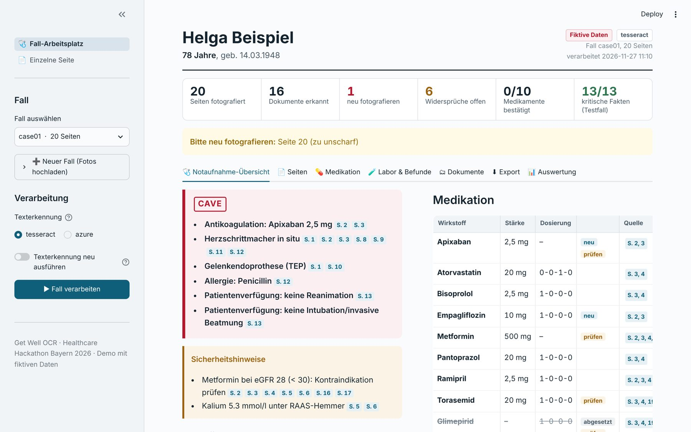
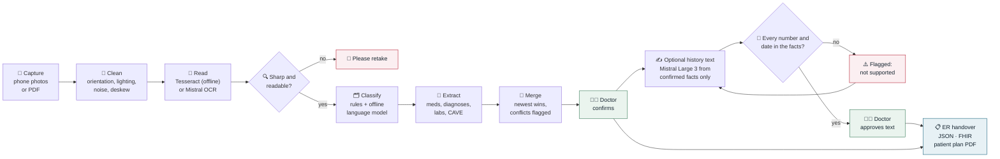
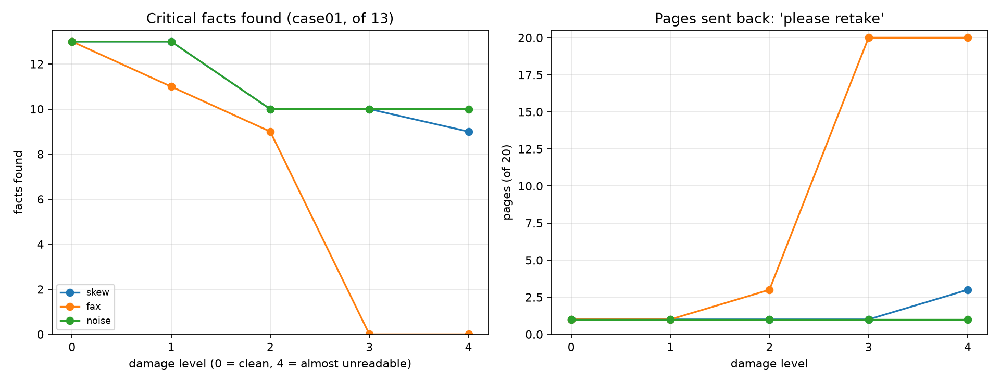
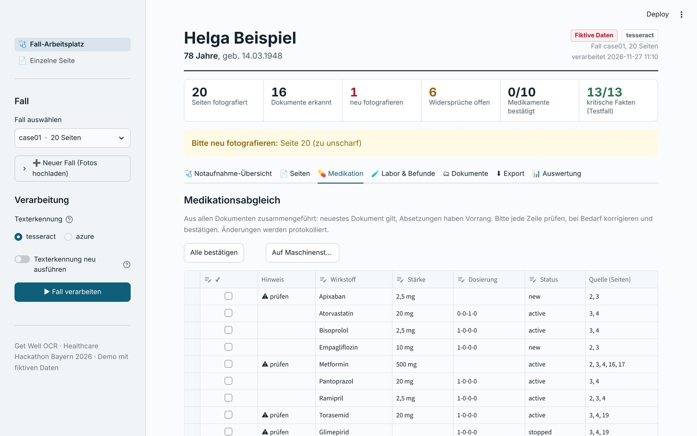

<div align="center">


# Get Well OCR

### From a bag of paper to a safe ER handover in minutes

**Healthcare Hackathon Bayern 2026 · Challenge #3 "From paper to PC"**


-0F5E7A)


</div>

---

## 🚑 The problem

A patient arrives in the emergency room at night with a **bag full of paper**: discharge letters, an old medication plan, lab results, a fax from the GP. The doctor has minutes, not hours.

The critical facts are scattered: the **penicillin allergy** is only in a letter from 2022, the **blood thinner was switched**, and the nursing form says *"no allergies"*.

## 💡 What Get Well OCR does

> Photograph every page with a phone. Get Well OCR reads, sorts and cross-checks them, shows what is **dangerous** first, flags **contradictions**, and writes the ER handover. **Every line links to its source page.**

<table>
<tr>
<td width="50%"></td>
<td width="50%"></td>
</tr>
<tr>
<td align="center"><b>ER overview:</b> CAVE first, medication reconciled across all documents</td>
<td align="center"><b>Every fact is traceable:</b> highlighted on the original page</td>
</tr>
</table>

---

## 🔄 How it works



| Step | What happens | Why it matters |
|---|---|---|
| 🧼 **Clean** | Turns sideways pages upright, evens out shadows, removes noise, straightens tilted photos | Bad phone photos are the normal case in an ER |
| 📖 **Read** | Tesseract on the laptop, or Mistral Document AI (Azure, EU region) for tables, handwriting and poor photos | Choose offline privacy or higher accuracy per case |
| 🔍 **Quality gate** | Blurry or unreadable pages are sent back: *"please retake"* | The system never guesses on pages it cannot read |
| 🗂️ **Classify** | Keyword rules **and** a small multilingual model (runs on a laptop) | When they disagree, the doctor is asked |
| 🔀 **Merge** | One medication list from all documents: new, stopped, changed | Old plans don't overwrite new letters |
| ⚠️ **Conflicts** | Contradictions are shown, never silently resolved | *"Allergies: none"* vs. *"penicillin allergy"* |
| 👩‍⚕️ **Review** | Doctor confirms or corrects; every change is logged | Exports unlock only after confirmation |
| ✍️ **History text** | Mistral Large 3 turns the **confirmed** facts into a short history in doctor's-letter style. It never sees photos or raw OCR text, runs at temperature 0, and every number and date it writes is checked against the facts | The language model can phrase, not invent. Anything unsupported is flagged, and the doctor must approve the text |

---

## 📊 Results (fictional 20-page test case, Tesseract offline)

<table>
<tr><td>

| Metric | Result |
|---|---|
| 🎯 Critical facts found | **13 / 13** |
| 🗂️ Pages classified correctly | **19 / 19** |
| ⚠️ Document conflicts flagged | **6** (5 planted + 1) |
| 📸 Blurry page detected | **✓** retake requested |
| 📄 Harder case (handwriting, sideways pages) | **13 / 14** |

</td><td>

| Classifier | Pages correct |
|---|---|
| Keyword rules | 19 / 19 |
| Language model alone | 14 / 19 |
| **Hybrid (both)** | **19 / 19** |

<sub>The model has never seen our documents.<br/>Disagreements are shown to the doctor.</sub>

</td></tr>
</table>

### 🧪 Stress test: 480 deliberately damaged pages



Six kinds of damage (blur, noise, skew, shadow, WhatsApp compression, fax) at four levels each. **Shadows and compression barely matter.** Heavy blur and fax are **sent back for a retake** instead of producing silent mistakes.

---

## 🖥️ The app



Login first (see [Quick start](#-quick-start)). The **start screen** takes photos or PDFs, lets you choose the OCR engine (Tesseract or Mistral OCR) and pick an earlier case. *Delete history* removes every uploaded case; the test cases stay.

| Tab | For |
|---|---|
| 🩺 **ER overview** | CAVE, safety warnings, conflicts to clarify, medication, diagnoses, contact person |
| 📄 **Pages** | All photos, document type per page, highlighted sources (Mistral OCR returns no positions: sources are listed as text instead) |
| 💊 **Medication** | Doctor reviews, corrects and confirms; correction log |
| 🧪 **Labs & findings** | Latest values with trend |
| 🗂️ **Documents** | Timeline, pages grouped into documents |
| ⬇️ **Export** | Optional history text by Mistral Large 3 (after all medication is confirmed), ER handover text (DE/EN), JSON, FHIR R4, CSV, patient plan PDF in 🇩🇪 🇬🇧 🇹🇷 🇨🇳 |

---

## 🚀 Quick start

```bash
git clone https://github.com/uromi06/get_well_OCR.git
cd get_well_OCR
./start.sh          # macOS / Linux
start.bat           # Windows (or double-click it)
```

That's it. On the first start the launcher sets up everything by itself, then opens **http://localhost:8501**:

1. finds Python 3.10 to 3.13 (prefers 3.12), or installs 3.12 (brew / winget / apt)
2. creates `.venv` and installs `requirements.txt` (later starts reinstall only when the file changed)
3. installs Tesseract with German (brew / winget / apt / dnf), or downloads missing language data into `.tessdata/`
4. creates `.env` from `.env.example`

> 🔑 **Set a login before the first use:** put `APP_USERNAME` and `APP_PASSWORD` into `.env`. Without them the app shows an error instead of opening.
> Optional: fill in the `MISTRAL_*` values to enable Mistral OCR and the AI-written history. Without them everything runs with Tesseract.

Later starts take a few seconds. Options: `--setup-only`, `--self-test` (also checks German OCR on a test page), `--port 8600`, `--no-browser`; anything else is passed to `streamlit run`. `python start.py` works on any OS too.

Pipeline and test scripts (after the first start):

```bash
source .venv/bin/activate              # Windows: .\.venv\Scripts\Activate.ps1
python scripts/process_case.py         # runs the test case, prints the scorecard
```

<details>
<summary><b>🔧 Requirements and options</b></summary>

- Python 3.12 and Tesseract 5 with the **German** language pack. `start.sh` / `start.bat` install both. Manual install on Windows: [UB Mannheim build](https://github.com/UB-Mannheim/tesseract/wiki)
- Login: `APP_USERNAME` and `APP_PASSWORD` in `.env` (required)
- Optional: Mistral on Azure AI Foundry (EU region, Sweden Central): `MISTRAL_API_KEY`, `MISTRAL_OCR_ENDPOINT`, `MISTRAL_CHAT_ENDPOINT` in `.env` (**never commit it**)
- Optional: Azure Document Intelligence (EU region), endpoint and key in `.env`
- The classifier model (`multilingual-e5-small`, ~120 MB) downloads once, then runs offline

```powershell
python scripts\process_case.py --classifier rules|model|hybrid
python scripts\process_case.py --engine mistral|azure
python scripts\process_case.py --pages data\cases\case01_hard\pages_photo
python scripts\make_stress_set.py ; python scripts\run_stress.py --quick
```
</details>

<details>
<summary><b>📁 Project structure</b></summary>

```
get_well_OCR/
├── start.sh / start.bat    One-command launcher: sets up the environment, starts the app
├── app.py                  Streamlit entry point (login gate, one screen)
├── api.py                  HTTP API (FastAPI): upload pages, get the text back
├── assets/                 Logo and wordmark
├── views/                  Screens (case workspace, UI components)
├── src/                    Pipeline: no UI code, reusable by the API
│   ├── preprocess.py       Image cleanup (orientation, lighting, noise, deskew)
│   ├── extract.py          OCR: Tesseract, Mistral Document AI or Azure Document Intelligence
│   ├── mistral.py          Mistral OCR and Mistral Large 3 calls (cached for offline demos)
│   ├── case.py             Multi-page pipeline: quality, classify, extract, merge
│   ├── doc_classifier.py   Offline language model for document types
│   ├── history.py          AI-written history from confirmed facts, with grounding check
│   ├── report.py           ER handover text
│   ├── export.py           JSON, CSV, FHIR, patient plan PDF
│   ├── store.py            Case folders, uploads, doctor review, delete history
│   └── auth.py             Login for the web app
├── scripts/                Run, evaluate, generate test data
├── deploy/                 CD to AWS (GitHub Actions → ECR → EC2), see deploy/CD.md
└── data/cases/             Fictional test cases + answer files (see its README)
```
</details>

<details>
<summary><b>🧪 Test data</b></summary>

All patients are **fictional** (every page is marked *FIKTIV*). Main case: *Helga Beispiel, 78*, shortness of breath, 20 pages across 15 documents, with planted traps: an outdated medication plan, a false *"no allergies"*, a blurry duplicate, an irrelevant insurance letter. Details in [`data/cases/README.md`](data/cases/README.md).
</details>

---

## 🔒 Privacy and safety by design

| Mode | What leaves the laptop |
|---|---|
| 💻 **Tesseract (offline)** | Nothing. OCR, classification and extraction run locally |
| 🇪🇺 **Mistral OCR** | Page images, sent to Mistral Document AI on Azure AI Foundry in an EU region (Sweden Central) |
| ✍️ **AI history text** | Only the doctor-confirmed facts (no photos, no raw text), sent to Mistral Large 3 in the same EU region |

- 🧪 **Fictional data only** in this repository and in the cloud modes
- 🔑 The web app opens **only after login**
- 🗃️ Mistral results are cached locally, so the demo also works without a connection
- 🗑️ One click **deletes every uploaded case** (photos, OCR, results, review)
- 👩‍⚕️ **Nothing is exported** before a doctor has confirmed it, and the AI history text must be approved separately

---

## ☁️ Deployment

Every push to `main` builds a Docker image, smoke-tests it and, after manual approval, deploys it to AWS EC2 (API on port 8000, Streamlit app with login on port 8501), with automatic rollback. Setup and details: [`deploy/CD.md`](deploy/CD.md).

---

## 👥 Team

| | Name | GitHub | Role |
|---|---|---|---|
| 🩺 | **Maxwell** | | ER doctor, clinical requirements |
| 🧠 | **Urmi** | [@uromi06](https://github.com/uromi06) | AI pipeline |
| 👤 | **Peter** | | *role* |
| 👤 | **Lennart** | [@KTV02](https://github.com/KTV02) | *role* |
| 👤 | **Hoang** | [@HoangStud13](https://github.com/HoangStud13) | *role* |
| 👤 | **Subhangee** | | *role* |

<div align="center">
<sub>Made with ☕ at the Healthcare Hackathon Bayern 2026, Munich</sub>
</div>
