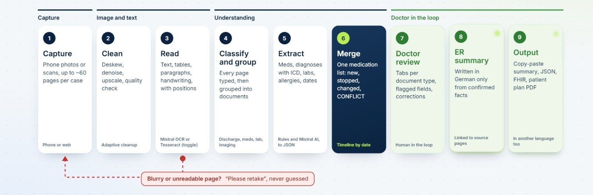

<div align="center">


# Get Well OCR

### From a bag of paper to a safe ER handover in minutes

**Healthcare Hackathon Bayern 2026 · Challenge #3 "From paper to PC"**


-0F5E7A)


</div>

---

## 🚑 The problem

A patient arrives in the ER at night with a **bag of paper**: discharge letters, an old medication plan, lab results, a GP fax. The critical facts are scattered: the **penicillin allergy** is only in a letter from 2022, the **blood thinner was switched**, and the nursing form says *"no allergies"*.

**Get Well OCR** turns phone photos of those pages into a checked ER handover: **dangerous facts first**, **contradictions flagged**, **every line linked to its source page**. The doctor confirms before anything is exported.

<table>
<tr>
<td width="50%"></td>
<td width="50%"></td>
</tr>
<tr>
<td align="center"><b>ER overview:</b> CAVE first, medication reconciled across all documents</td>
<td align="center"><b>Every fact is traceable:</b> highlighted on the original page</td>
</tr>
</table>

---

## 🔄 How it works



| | Step | How | AI? |
|---|---|---|---|
| 1 | **Capture** | Phone app or web, photos or PDFs, up to ~60 pages; PatientenID by barcode scan | – |
| 2 | **Clean** | OpenCV: find the sheet and crop it like a scan, turn upright, even out light, denoise, deskew | – |
| 3 | **Read** | Tesseract (offline) or Mistral OCR (Mistral Large 3, Azure EU). **Blurry or unreadable → "please retake", never guessed** | ✅ |
| 4 | **Classify + group** | Keyword rules **and** an offline multilingual model (`multilingual-e5-small`); disagreements are shown | ✅ |
| 5 | **Extract** | Meds, diagnoses (ICD-10), labs, allergies, implants, directives. Rules, or Mistral Large 3 with every fact tied to its source line | optional |
| 6 | **Merge** | One medication list: newest document wins, stops win, contradictions listed under *Zu klären* | rules |
| 7 | **Doctor review** | Confirm or correct each drug, resolve conflicts; every change is logged | 👩‍⚕️ |
| 8–9 | **Summary + output** | ER text (DE/EN), JSON, FHIR R4, CSV, patient plan PDF in 🇩🇪 🇬🇧 🇹🇷 🇨🇳 | – |

**AI where the input is messy** (reading, sorting), **fixed rules where safety needs to be explainable** (what is current, what contradicts), **the doctor decides**.

### 💊 AI medication safety check

With AI extraction, Mistral Large 3 also checks each page for **acutely dangerous doses** (e.g. far above the daily maximum, methotrexate daily instead of weekly, metformin at eGFR < 30 on the same page) and **dangerous combinations** (e.g. two anticoagulants, anticoagulant + NSAID, methotrexate + co-trimoxazole).

- Only acute dangers are shown: each alert is rated *akut / grenzwertig / langfristig* and only *akut* is kept; suboptimal or long-term issues, standard combinations and documented dose adjustments are not flagged
- Alerts are only kept if every drug they name was extracted from that page, and are dropped when a later document stops the drug
- Shown as a short red line inside the **Medikation** card (phone app) or above the medication table (web app) and in the handover text, marked *"KI-Prüfung, ärztlich bewerten"*

---

## 📊 Results

Fictional 20-page test case (Helga Beispiel, 15 documents, planted traps), Tesseract offline unless noted.

| Metric | Result |
|---|---|
| 🎯 Critical facts found | **13 / 13** (harder case with handwriting and sideways pages: 13 / 14) |
| 🗂️ Pages classified correctly | **19 / 19** (rules alone 19, language model alone 14, hybrid 19) |
| ⚠️ Conflicts flagged | **6** (5 planted + 1) |
| 📸 Blurry page | **detected**, retake requested |
| 🤖 Mistral OCR → Mistral Large 3 | 13 / 13 facts, exactly the 5 planted conflicts |

<details>
<summary><b>🧪 Stress test: the same case, deliberately damaged</b></summary>


Skew and noise: at least 9 of 13 facts at the worst level. Fax from level 3: every page is sent back for a retake, so nothing is read wrongly. Reproduce with `python scripts/run_stress.py --quick` and `python scripts/compare_extractors.py`.
</details>

---

## 🖥️ The app


| Tab | For |
|---|---|
| 🩺 **ER overview** | CAVE, warnings, AI corrections, conflicts to clarify, medication, diagnoses, contact |
| 📄 **Pages** | Photos, document type per page, highlighted sources |
| 💊 **Medication** | Review and confirm, correction log, **dose history per drug** across all documents |
| 🧪 **Labs & findings** | Latest values with trend |
| 🗂️ **Documents** | Timeline, pages grouped into documents |
| ⬇️ **Export** | Handover text, JSON, FHIR R4, CSV, patient plan PDF |

📱 **Phone app (PWA):** install from the phone browser, frame the sheet live with the camera (it is found and cropped automatically), read with Mistral OCR and get the handover on the phone. Same cases as the web app. Start locally with `uvicorn pwa.server:app --port 8000`.

---

## 🚀 Quick start

```bash
git clone https://github.com/uromi06/get_well_OCR.git
cd get_well_OCR
./start.sh          # macOS / Linux
start.bat           # Windows (or double-click it)
```

The launcher installs Python, the packages and Tesseract with German if needed, creates `.env` from [`.env.example`](.env.example) and opens **http://localhost:8501**.

> 🔑 Fill in `.env`: the login (`APP_USERNAME` / `APP_PASSWORD`) and, for Mistral, `MISTRAL_API_KEY` + `MISTRAL_CHAT_ENDPOINT`. **`.env` is never committed.** Without Mistral keys everything runs offline with Tesseract.

<details>
<summary><b>🔧 Options and scripts</b></summary>

- Launcher: `--setup-only`, `--self-test`, `--port 8600`, `--no-browser`; `python start.py` works on any OS
- `.env` defaults: `OCR_ENGINE=tesseract|mistral`, `EXTRACTOR=rules|llm`, `OCR_WORKERS=2` (also switchable in the app)
- Mistral runs on Azure AI Foundry, Sweden Central. The classifier model downloads once, then runs offline

```bash
python scripts/process_case.py                         # test case + scorecard
python scripts/process_case.py --engine mistral        # with Mistral OCR
python scripts/compare_extractors.py --engine mistral  # rules vs. AI extraction
python scripts/make_stress_set.py ; python scripts/run_stress.py --quick
```
</details>

<details>
<summary><b>📁 Project structure</b></summary>

```
get_well_OCR/
├── start.sh / start.bat   One-command launcher
├── app.py                 Streamlit web app (login, case workspace)
├── pwa/                   Installable phone app + case API, same pipeline
├── api.py                 HTTP API: upload pages, get the text back
├── views/                 Web app screens and components
├── src/
│   ├── preprocess.py      Page detection and image cleanup
│   ├── extract.py         OCR: Tesseract, Mistral OCR, Azure Document Intelligence
│   ├── doc_classifier.py  Offline language model for document types
│   ├── case.py            Multi-page pipeline: quality, classify, extract, merge
│   ├── llm_extract.py     AI extraction with Mistral Large 3, grounded in source lines
│   ├── mistral.py         Mistral calls (cached for offline demos)
│   ├── report.py          ER handover text
│   ├── export.py          JSON, CSV, FHIR, patient plan PDF
│   ├── store.py           Case folders, review, delete history
│   └── auth.py            Login
├── scripts/               Run, evaluate, generate test data
├── deploy/                CD to AWS, see deploy/CD.md
└── data/cases/            Fictional test cases + answer files
```
</details>

---

## 🔒 Privacy and safety

| Mode | What leaves the laptop |
|---|---|
| 💻 Tesseract + rules | Nothing |
| 🇪🇺 Mistral OCR / AI extraction | Page images or OCR text, to Mistral Large 3 on Azure in Sweden |

🧪 Fictional data only · 🔑 login required · 🗃️ Mistral results cached for offline demos · 🗑️ one click deletes all uploaded cases · 👩‍⚕️ nothing is exported before a doctor confirms

**Deployment:** every push to `main` is tested and, after approval, deployed to AWS with automatic rollback ([`deploy/CD.md`](deploy/CD.md)).

---

## 👥 Team

Six people, one weekend, one bag of paper.

| | Who | Role |
|---|---|---|
| 🩺 | **Maxwell** · [@maxwellwolfrum](https://github.com/maxwellwolfrum) | ER doctor: clinical requirements, validation of the simulated cases, testing and pitch |
| 🧠 | **Urmi** · [@uromi06](https://github.com/uromi06) | AI pipeline: classification, extraction, cross-document checks, handover and evaluation |
| 🧼 | **Subhangee** · [@Subhangee](https://github.com/Subhangee) | Image preprocessing with OpenCV, PaddleOCR evaluation and testing |
| ☁️ | **Hoang** · [@hoangStud13](https://github.com/hoangStud13) | AWS deployment, hosting and the phone app UI |
| 🔐 | **Lennart** · [@KTV02](https://github.com/KTV02) | Launcher, login, Mistral integration, tunneling, deployment and testing |
| 🎤 | **Peter** · [@PedroLemonade](https://github.com/PedroLemonade) | Pitch, slides and iOS app prototype |

<div align="center">
<sub>Made with ☕ at the Healthcare Hackathon Bayern 2026, Munich</sub>
</div>
